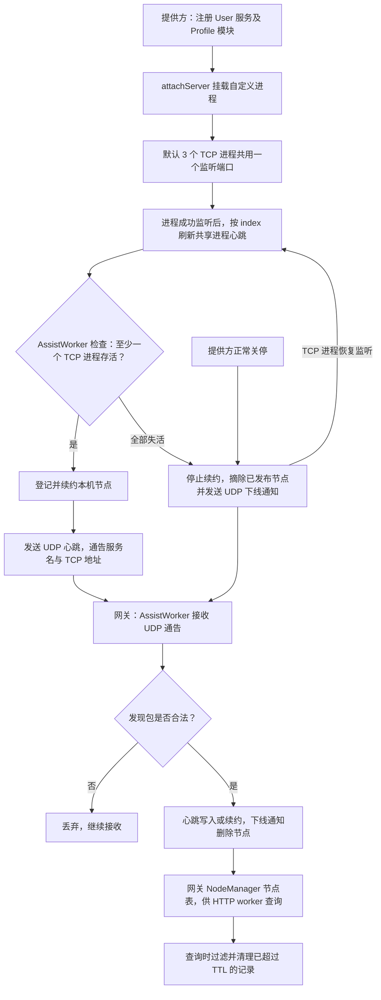
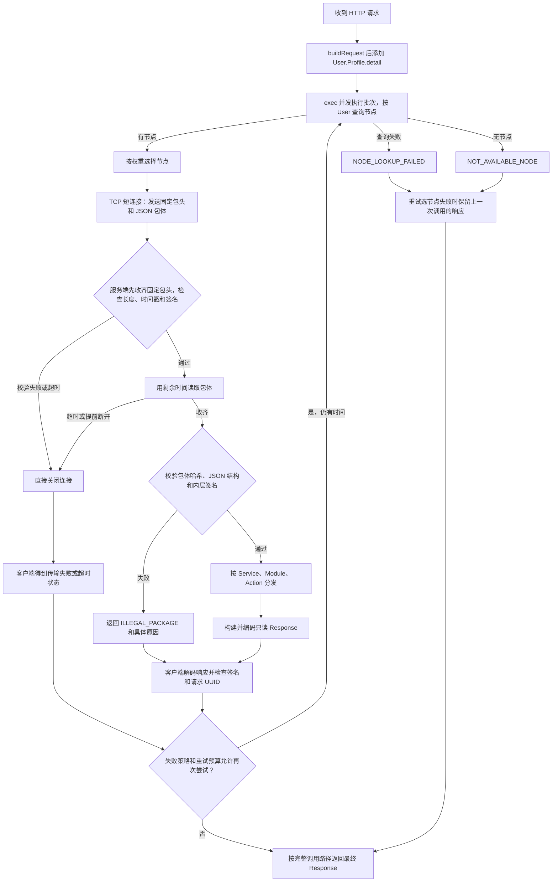

# RPC 安装与接入

EasySwoole RPC 通过 Swoole 协程和 TCP 短连接调用远程服务。调用路径由服务名、模块名和 Action 组成，例如 `User.Profile.detail`。提供方注册这条路径，调用方通过节点管理器取得服务的 TCP 地址。

## 设计原理

### 服务启动与节点发现

提供方的 RPC TCP 进程开始监听后，辅助进程才登记节点，并在启用 UDP 时向网关通告。网关把收到的节点写入本机共享表，供 HTTP Worker 查询。



### 单次调用

调用方按服务名查询节点，选出目标后通过 TCP 发送请求。服务端按服务、模块和 Action 分发，客户端校验响应，再按失败策略决定是否重试。



两张流程图来自 [RPC 6.0.1 上游 README](https://github.com/easy-swoole/rpc/blob/6.0.1/README.md#设计与调用流程)。

## 安装

本文以 `easyswoole/rpc` **6.0.1** 为准，需要 PHP 8.1+、Swoole 5.1+ 和 `easyswoole/component:^2.5`。在 EasySwoole 应用项目根目录执行：

```bash
composer require 'easyswoole/rpc:^6.0.1'
composer show easyswoole/rpc
```

## 定义项目的 RPC 入口

新建 `App/Rpc/MyRpc.php`：

```php
<?php

namespace App\Rpc;

use EasySwoole\Component\Singleton;
use EasySwoole\Rpc\Rpc;

final class MyRpc extends Rpc
{
    use Singleton;
}
```

每个应用通过 `MyRpc::getInstance()` 访问 RPC。首次调用传入该应用的配置和依赖。需要挂载 RPC 或 UDP 发现进程的 EasySwoole 应用，在主进程的 `EasySwooleEvent::mainServerCreate()` 中完成初始化和挂载，Worker 启动后即可使用已配置的实例。

接下来创建[服务提供方](/Microservice/Rpc/server.md)，再用[客户端](/Microservice/Rpc/client.md)验证调用。

## 源码依据

- [RPC 6.0.1 源码](https://github.com/easy-swoole/rpc/tree/6.0.1)
- [Composer 包](https://packagist.org/packages/easyswoole/rpc)
